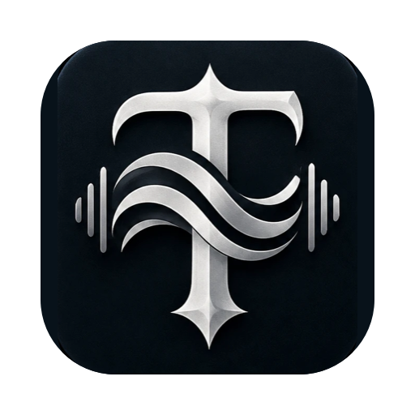
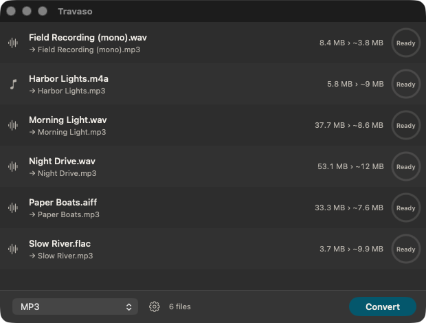
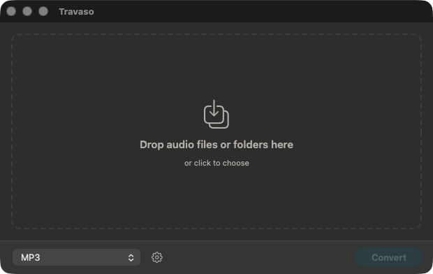
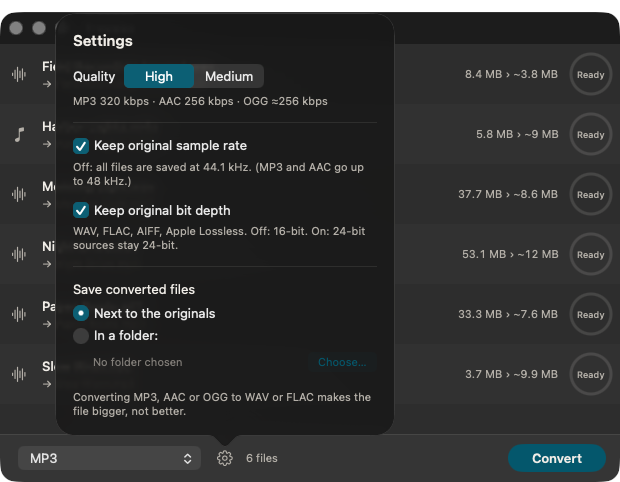
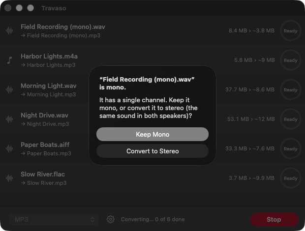
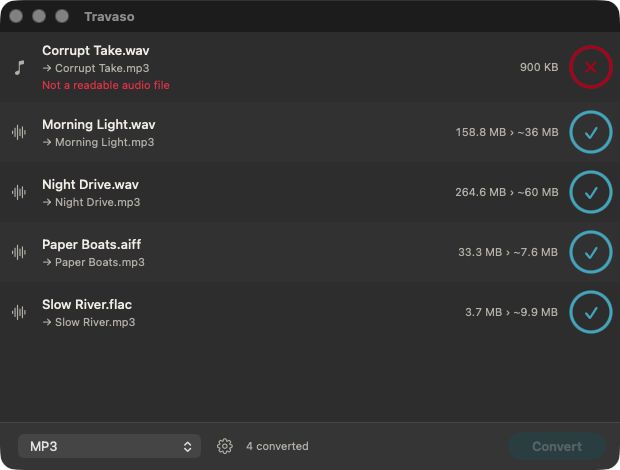

<div align="center">



# Travaso

**Drop in audio, pick a format, get your files back.**

A small, fast audio converter for the Mac. Everything runs on your machine, nothing is uploaded.

[](https://github.com/SteveAnthonyFM/Travaso/releases/latest)
[](LICENSE)


[**Download**](https://github.com/SteveAnthonyFM/Travaso/releases/latest) ·
[What it does](#what-it-does) ·
[Install](#install) ·
[User guide](docs/USER_GUIDE.md) ·
[Build from source](#build-from-source)

<br />



<sub>Screenshots use sample files.</sub>

</div>

<br />

## What it does

You drag files (or whole folders) onto the window, choose a format in the menu at the bottom, and press
**Convert**. That's the whole app.

- **Seven output formats:** MP3, WAV, FLAC, AIFF, AAC (.m4a), Apple Lossless (.m4a) and OGG Vorbis.
- **Folders welcome.** Drop a folder and Travaso finds the audio inside, subfolders included.
- **Quick.** Up to four files convert at once, each with its own progress ring.
- **Safe.** Your original is never touched. Files are written to a temporary name and only moved into place
  when they're complete, so a stopped or failed job leaves nothing half-written behind.
- **Polite.** It asks before turning a mono file into stereo, and before replacing a file that already
  exists. Tick *Apply to all* and it won't ask again for that batch.
- **Tags kept.** Title, artist, album and the rest of the text tags come along.
- **Private.** No account, no network, no upload.

<table>
  <tr>
    <td align="center" width="50%">
      <br />
      <sub><b>Start</b>: drop files or folders, or click to choose</sub>
    </td>
    <td align="center" width="50%">
      <br />
      <sub><b>Settings</b>: quality, sample rate, bit depth, where files go</sub>
    </td>
  </tr>
  <tr>
    <td align="center">
      <br />
      <sub><b>Questions first</b>: asked up front, never mid-batch</sub>
    </td>
    <td align="center">
      <br />
      <sub><b>Done</b>: a clear message if a file can't be read; double-click a row to show it in Finder</sub>
    </td>
  </tr>
</table>

## Install

1. Download `Travaso-<version>.dmg` from the [latest release](https://github.com/SteveAnthonyFM/Travaso/releases/latest).
2. Open it and drag **Travaso** to **Applications**.
3. The first time, **right-click Travaso and choose Open** (the app isn't notarized yet, so macOS asks once).

Requires an Apple Silicon Mac running macOS 26 or later.

## Good to know

- Converting MP3, AAC or OGG to WAV or FLAC makes files bigger, not better: detail that's already
  gone can't come back.
- Surround files are mixed down to stereo.
- Album art isn't copied (text tags are).
- Output defaults to 44.1 kHz / 16-bit. Turn on *Keep original sample rate* or *Keep original bit depth*
  in Settings to preserve the source.

The [User Guide](docs/USER_GUIDE.md) covers every setting, prompt and error message.

## Build from source

Needs Xcode and Homebrew.

```
brew install pkgconf          # one-time helper for the FFmpeg build
./Scripts/build-ffmpeg.sh     # builds FFmpeg from official sources (5-10 min, once)
./Scripts/build-release.sh    # builds Travaso and installs it in /Applications
```

For day-to-day work, open `Travaso.xcodeproj` in Xcode and press ⌘R. See the
[Developer Guide](docs/DEVELOPER_GUIDE.md) for project layout and how conversion works.

## How it works

Conversion is done by FFmpeg, bundled inside the app as a separate program and built from official sources
as an LGPL (non-GPL) build with LAME, libogg and libvorbis. Details and checksums are in
[docs/FFMPEG.md](docs/FFMPEG.md).

## Background

Travaso started as a personal replacement for Adapter by Macroplant, which was the model for its
"drop files in, pick a format" simplicity. It is an independent project and isn't affiliated with Adapter or
Macroplant.

## License

MIT. FFmpeg and its libraries keep their own licenses; see
[THIRD_PARTY_NOTICES.md](THIRD_PARTY_NOTICES.md). Version history is in the [changelog](CHANGELOG.md).
